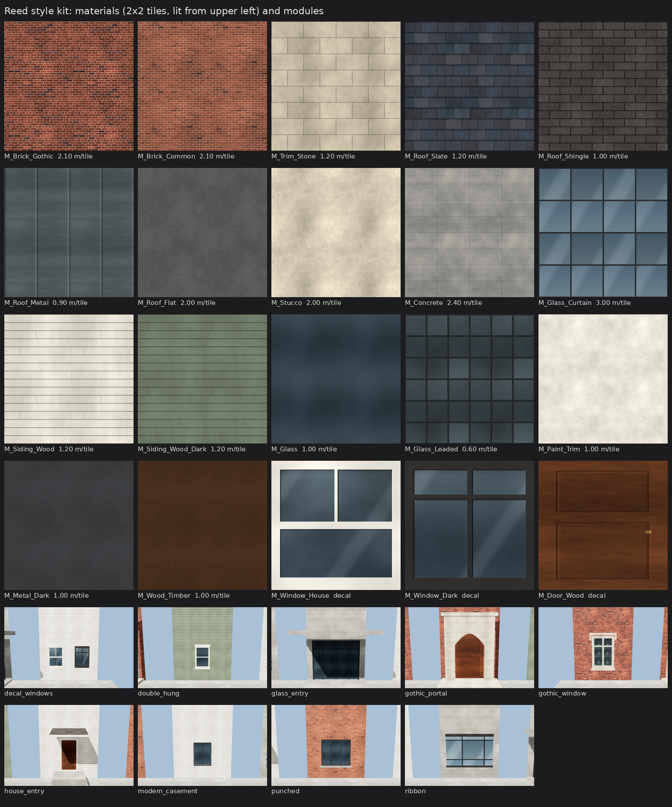

# Reed style kit

Original procedural assets for making Reed College's buildings look like Reed's, in Unreal and three.js. All of it is generated here: no photographs, no third-party textures.

```
python3 world/buildings/kit/make_kit.py            # textures/ + materials.json (about 20 s)
python3 scripts/build_buildings.py --modules       # world/buildings/out/reed_buildings_detailed.glb (+ module showcase)
python3 world/buildings/kit/verify_glb.py          # load, names, winding, outward walls, upward roofs, UV scale
python3 world/buildings/kit/render_preview.py      # three.js r128 renders -> out/preview/ (add --modules for modules)
python3 world/buildings/kit/contact_sheet.py       # contact_sheet.png
python3 scripts/export_unreal.py --detailed-only   # copy into world/unreal/
```



## Materials (`textures/`, `materials.json`)

Each material has three tileable maps (numpy FFT noise, so every texture wraps without seams):

| Map | Contents |
|---|---|
| `T_<Name>_BC.png` | Base colour (sRGB) |
| `T_<Name>_N.png` | Normal map from a height field, **OpenGL / glTF convention** (+Y up). Unreal's is DirectX, so `import_reed.py` sets `flip_green_channel`. |
| `T_<Name>_ORM.png` | R = AO (1), G = roughness, B = metallic. This is glTF's metallicRoughness layout. |

**Texel scale is real.** `tile_m` is the size of one texture repeat in metres, and `build_buildings.py` writes UVs as metres ÷ `tile_m`. A brick is 20 × 6.5 cm with 1 cm joints: the 2.10 m brick tile holds exactly 10 bricks by 28 courses. `verify_glb.py` checks the scale on every wall face.

| Material | Tile | Notes |
|---|---|---|
| `Brick_Gothic` | 2.10 m | Running bond with a header course every 6th course, fire-flashed ends and about 7 % purple-brown clinkers |
| `Brick_Common` | 2.10 m | Mid-century running bond, more even |
| `Trim_Stone` | 1.20 m | Cast stone / limestone ashlar, with weathering streaks |
| `Roof_Slate` | 1.20 m | 30 cm slates, 20 cm exposure, half-lap |
| `Roof_Shingle` | 1.00 m | 3-tab asphalt shingle |
| `Roof_Metal` | 0.90 m | Standing seam, 45 cm pans (painted, metallic 0.25) |
| `Roof_Flat` | 2.00 m | Ballasted membrane |
| `Stucco` | 2.00 m | |
| `Concrete` | 2.40 m | Board-marked, 1.2 × 0.6 m panels with tie holes |
| `Glass_Curtain` | 3.00 m | 1.5 m panels, 6 cm mullions |
| `Siding_Wood`, `Siding_Wood_Dark` | 1.20 m | 15 cm painted lap siding (cream, sage) |
| `Glass`, `Glass_Leaded` | 1.0 m / 0.6 m | Leaded quarries for the Gothic windows |
| `Paint_Trim`, `Metal_Dark`, `Wood_Timber` | 1.0 m | Plain finishes |
| `Window_House`, `Window_Dark`, `Door_Wood` | decal | Whole-window or door-leaf textures, UV 0..1 over the quad (used for neighbourhood windows) |

Image top always means "up": up the wall, or up the roof slope.

## Modules (in `scripts/build_buildings.py`)

All modules are geometry in a wall-local frame (along / up / outward), with triangle counts as built:

| Module | Triangles | Description |
|---|---:|---|
| `win_gothic` | 48 | Stone surround with reveals, stone mullion and transom, leaded glass, square drip-mould (label) with returns, sill |
| `entry_gothic` | 78 | Projecting stone surround with a four-centred (Tudor) arch, timber doors, label mould, stone step |
| `win_double_hung` | 36 | Painted casing, meeting rail, sill, head casing. As a neighbourhood decal: 2. |
| `win_punched` | 22 | Mid-century aluminium frame, 3 lights, cast sill |
| `win_modern` | 16 | Dark casement |
| `ribbon` | 18 | Continuous band of curtain glazing with a projecting head and sill. The ground floor of contemporary buildings gets a storefront. |
| `entry_modern` | 62 | Glass doors and sidelights, concrete canopy and step |
| `entry_house` | 28 | Panelled door, casing, stoop, shed porch roof |

Style families (`STYLES` in the script) set the wall, roof and trim materials, storey height (3.6 m for Gothic, 3.8–4.2 m for academic, 3 m for residences), window size and bay spacing, plinth, overhang and entry type. `styles.csv` picks the family and overrides materials and window type through its free-text columns.

Previews of every module are in `../out/preview/module_*.png`.
